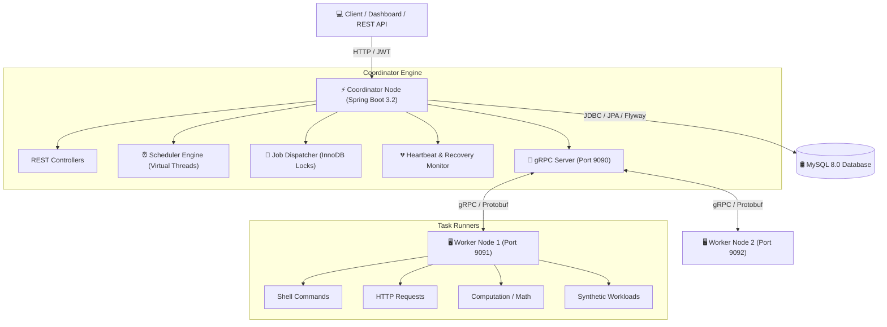
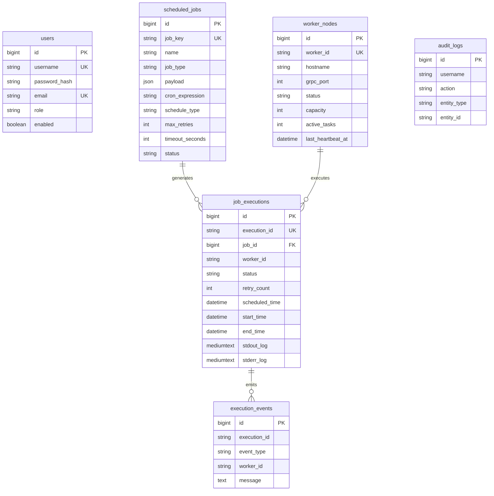

# Distributed Task Scheduler

Enterprise-grade, highly available **Distributed Task Scheduler** built with **Java 21**, **Spring Boot 3.x**, **MySQL 8.0 (InnoDB)**, **Flyway**, **gRPC**, **Protocol Buffers**, and **Java 21 Virtual Threads**.

---

## 🌟 Architectural Features

- **Spring Boot 3.2+ & Java 21 Virtual Threads**: Handles thousands of concurrent task dispatches with lightweight virtual threads (`spring.threads.virtual.enabled=true`).
- **MySQL 8.0 Primary Storage**: Uses MySQL InnoDB as the single source of truth for jobs, workers, executions, events, and audit logs.
- **Atomic Job Claiming**: Implements MySQL InnoDB pessimistic row-level locking (`SELECT FOR UPDATE`) to prevent duplicate task dispatching across clustered nodes.
- **gRPC & Protocol Buffers**: High-performance, low-latency binary RPC communication between the Coordinator and Worker nodes.
- **Flyway Database Migrations**: Versioned database migrations (`V1__init_schema.sql`, `V2__seed_data.sql`).
- **Worker Heartbeat Monitoring & Failover**: Automatic detection of dead/stale worker nodes (missed heartbeats > threshold) with automatic task reassignment and retry mechanisms.
- **Spring Security & JWT**: Role-Based Access Control (`ROLE_ADMIN`, `ROLE_OPERATOR`) with stateless JWT authentication for REST APIs.
- **Control Center Web Dashboard**: Real-time dark-mode UI embedded directly in the Coordinator application.

---

## 🏗 System Architecture Diagram



---

## 🛢️ Database Schema Diagram



---

## ⚙️ Environment Variables

| Variable | Description | Default Value |
| :--- | :--- | :--- |
| `DB_URL` | MySQL JDBC URL | Local development URL |
| `DB_USERNAME` | MySQL username | `root` |
| `DB_PASSWORD` | MySQL password | Required; supply outside source control |
| `PORT` | Coordinator REST port (Render supplies this) | `8080` |
| `CORS_ALLOWED_ORIGINS` | Comma-separated browser origins allowed to call the coordinator | Vercel production URL and local development URLs |
| `GRPC_PORT` | Coordinator gRPC server port | `9090` |
| `COORDINATOR_HOST` | Coordinator hostname used by a worker | `localhost` |
| `COORDINATOR_GRPC_PORT` | Coordinator gRPC port used by a worker | `9090` |
| `WORKER_ID` | Unique worker identifier | `worker-node-1` |
| `WORKER_HOSTNAME` | Worker hostname registered with coordinator | `localhost` |
| `WORKER_PORT` | Worker port registered with coordinator | `9091` |
| `JWT_SECRET` | Base64-encoded random JWT signing key (at least 32 decoded bytes; coordinator only) | Required; never commit it |
| `SCHEDULER_HEARTBEAT_TIMEOUT_SECONDS` | Stale heartbeat threshold | `15` |

---

## 🚀 Setup & Execution Guide

### Prerequisites
1. **Java 17 or newer JDK** installed and configured (the Maven compiler target is Java 17).
2. **MySQL Server 8.0** running locally or via Docker.
3. **Maven 3.8+**

### 1. Database Initialization
Ensure MySQL 8.0 is running and create the target database:
```sql
CREATE DATABASE IF NOT EXISTS distributed_scheduler;
```

### 2. Build the Maven Modules
The Maven aggregator and all three modules are under `backend`. Run these commands from the repository root in PowerShell:
```powershell
mvn -f .\backend\pom.xml -pl coordinator -am clean package
mvn -f .\backend\pom.xml -pl worker -am clean package
```

### 3. Run Coordinator Application
Spring Boot imports the ignored repository-root `.env` file when present. Create it from the template and edit it with your local MySQL password and a generated JWT key:

```powershell
Copy-Item .\.env.example .\.env
$bytes = New-Object byte[] 32
[Security.Cryptography.RandomNumberGenerator]::Create().GetBytes($bytes)
[Convert]::ToBase64String($bytes)
```

Copy the generated Base64 value into `JWT_SECRET` in `.env`, then set `DB_PASSWORD` there. The value must decode to at least 32 bytes; JJWT enforces the HMAC key-strength requirement, and the coordinator validates it at startup. Keep `.env` private and do not commit it. From the repository root, run:

```powershell
java -jar .\backend\coordinator\target\coordinator-1.0.0-SNAPSHOT.jar
```

You can instead set `DB_URL`, `DB_USERNAME`, `DB_PASSWORD`, and `JWT_SECRET` as process environment variables; environment variables take precedence over `.env`.

### 4. Run Worker Nodes
The worker uses a gRPC client to register with the coordinator and send heartbeats:
```powershell
$env:COORDINATOR_HOST = "localhost"
$env:COORDINATOR_GRPC_PORT = "9090"
$env:WORKER_ID = "worker-node-1"
java -jar .\backend\worker\target\worker-1.0.0-SNAPSHOT.jar
```

> **Dispatch limitation:** the coordinator calls the worker's `DispatchTask` gRPC RPC, but the worker module currently has no gRPC server implementation for that RPC. Registration and heartbeat support do not by themselves make task dispatch operational.

### 5. Access Dashboard
When the frontend is running locally, open:
```
http://localhost:8080/
```
Default Credentials:
- **Username**: `admin`
- **Password**: `Admin@123`

---

## 🐳 Docker Compose Deployment

Copy `.env.example` to `.env`, set unique local values for `DB_PASSWORD` and `JWT_SECRET`, then start the services:

```powershell
Copy-Item .env.example .env
docker compose up --build
```

The coordinator and worker Dockerfiles expect the repository root as their build context so they can copy `backend/pom.xml` and the sibling Maven modules. The repository-root `render.yaml` defines the coordinator web service and uses `backend/Dockerfile` with the root build context. Create a Render Blueprint from this file. In the coordinator service's **Environment** settings, provide:

- `DB_URL`: the complete JDBC URL for a MySQL database reachable from Render, for example `jdbc:mysql://<database-host>:3306/distributed_scheduler?useSSL=true&serverTimezone=UTC`. Replace the host with the real provider hostname; `localhost` is not valid for a hosted database.
- `DB_USERNAME` and `DB_PASSWORD`: the database credentials, entered as Render environment variables and not committed to the repository.
- `JWT_SECRET`: a newly generated Base64 string representing at least 32 cryptographically random bytes. Generate one locally with the PowerShell command above and enter it directly in Render; do not reuse a checked-in or example secret.
- `CORS_ALLOWED_ORIGINS`: the allowed frontend origin. The Blueprint defaults to the deployed Vercel origin; add any additional frontend origins as a comma-separated list if needed.

Render provides `PORT` automatically; Spring binds the HTTP server to `${PORT}` with `8080` as the local default. The Blueprint keeps the database credentials and JWT key as unsynchronized inputs (`sync: false`), so they must be supplied in Render before the service can start. `GRPC_PORT` defaults to `9090`; it is not the HTTP health-check port. The worker does not use `JWT_SECRET`. To create services manually instead, leave **Root Directory** blank, set the coordinator Dockerfile path to `backend/Dockerfile`, and use `.` (the repository root) as the Docker build context. Setting the Render root directory to `backend/worker` or another subdirectory makes the root-relative `COPY backend/...` instructions fail because those files are outside the build context.

After saving the Render environment variables, trigger a deploy and check the service logs for a successful application startup. Verify the service health at `https://<your-render-service>.onrender.com/actuator/health`; do not consider deployment healthy until it returns `{"status":"UP"}`.

---

## 🧪 Verification & Failover Demonstration

### 1. Job Creation & Execution
1. Open the dashboard at `http://localhost:8080/`.
2. Navigate to **Scheduled Jobs** and click **+ Create New Job**.
3. Create a **SHELL** or **COMPUTATION** job with cron `*/15 * * * * *`.
4. Observe the job automatically being claimed by the Coordinator engine, dispatched over gRPC to `worker-node-1`, and recorded in the MySQL `job_executions` table.

### 2. Demonstrating Worker Timeout & Task Failover Recovery
1. Start a long-running synthetic or shell task on `worker-node-1`.
2. Abruptly kill the worker process (`worker-node-1`).
3. After **15 seconds** (heartbeat timeout threshold), the Coordinator's `HeartbeatMonitorService`:
   - Detects `worker-node-1` as **DEAD**.
   - Identifies unfinished active tasks assigned to `worker-node-1`.
   - Automatically reassigns the tasks to status **PENDING**, increments `retry_count`, and dispatches them to **Worker Node 2**.
   - Emits an execution event `REASSIGNED` and logs an audit record in MySQL.
