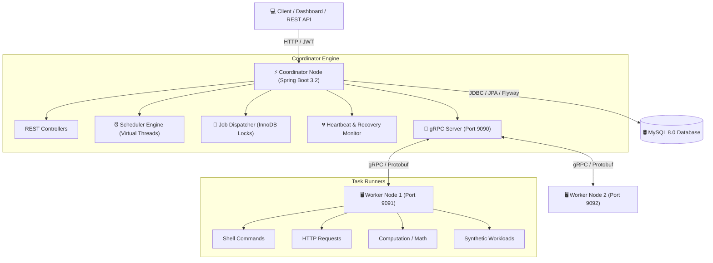
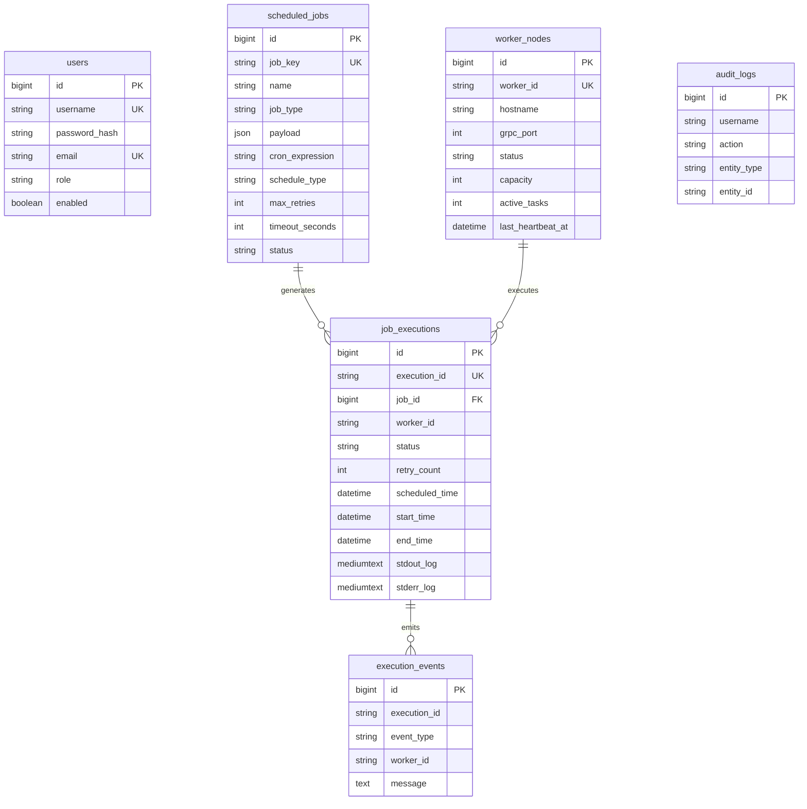

# Distributed Task Scheduler

Enterprise-grade, highly available **Distributed Task Scheduler** built with **Java 21**, **Spring Boot 3.x**, **MySQL 8.0 (InnoDB)**, **Flyway**, **gRPC**, **Protocol Buffers**, and **Java 21 Virtual Threads**.

---

## 🌟 Architectural Features

- **Spring Boot 3.2+ & Java 21 Virtual Threads**: Handles thousands of concurrent task dispatches with lightweight virtual threads (`spring.threads.virtual.enabled=true`).
- **MySQL 8.0 Primary Storage**: Uses MySQL InnoDB as the single source of truth for jobs, workers, executions, events, and audit logs.
- **Atomic Job Claiming**: Implements MySQL InnoDB pessimistic row-level locking (`SELECT FOR UPDATE`) to prevent duplicate task dispatching across clustered nodes.
- **gRPC & Protocol Buffers**: High-performance, low-latency binary RPC communication between the Coordinator and Worker nodes.
- **Flyway Database Migrations**: Versioned database migrations (`V1__init_schema.sql`, `V2__seed_data.sql`).
- **Worker Heartbeat Monitoring & Failover**: Automatic detection of dead/stale worker nodes (missed heartbeats > threshold) with automatic task reassignment and retry mechanisms.
- **Spring Security & JWT**: Role-Based Access Control (`ROLE_ADMIN`, `ROLE_OPERATOR`) with stateless JWT authentication for REST APIs.
- **Control Center Web Dashboard**: Real-time dark-mode UI embedded directly in the Coordinator application.

---

## 🏗 System Architecture Diagram



---

## 🛢️ Database Schema Diagram



---

## ⚙️ Environment Variables

| Variable | Description | Default Value |
| :--- | :--- | :--- |
| `DB_URL` | MySQL Connection JDBC URL | `jdbc:mysql://localhost:3306/distributed_scheduler` |
| `DB_USERNAME` | MySQL Username | `root` |
| `DB_PASSWORD` | MySQL Password | `Rahul@766` |
| `PORT` | Coordinator REST / Web Port | `8080` |
| `GRPC_PORT` | Coordinator gRPC Server Port | `9090` |
| `COORDINATOR_HOST` | Worker target Coordinator Host | `localhost` |
| `WORKER_ID` | Unique Worker Identifier | `worker-node-1` |
| `WORKER_GRPC_PORT` | Worker gRPC Task Server Port | `9091` |
| `HEARTBEAT_TIMEOUT` | Stale Heartbeat Timeout (seconds) | `15` |

---

## 🚀 Setup & Execution Guide

### Prerequisites
1. **Java 21 JDK** installed and configured.
2. **MySQL Server 8.0** running locally or via Docker.
3. **Maven 3.8+**

### 1. Database Initialization
Ensure MySQL 8.0 is running and create the target database:
```sql
CREATE DATABASE IF NOT EXISTS distributed_scheduler;
```

### 2. Build the Project
Build all submodules (`scheduler-proto`, `scheduler-coordinator`, `scheduler-worker`) using Maven:
```bash
mvn clean package -DskipTests
```

### 3. Run Coordinator Application
Start the Coordinator node (REST API on port 8080, gRPC Server on port 9090):
```bash
java -jar scheduler-coordinator/target/scheduler-coordinator-1.0.0-SNAPSHOT.jar
```

### 4. Run Worker Nodes
Start Worker Node 1 (gRPC port 9091):
```bash
java -jar scheduler-worker/target/scheduler-worker-1.0.0-SNAPSHOT.jar --worker.id=worker-node-1 --worker.grpc.port=9091 --server.port=8081
```

Start Worker Node 2 (gRPC port 9092):
```bash
java -jar scheduler-worker/target/scheduler-worker-1.0.0-SNAPSHOT.jar --worker.id=worker-node-2 --worker.grpc.port=9092 --server.port=8082
```

### 5. Access Dashboard
Open your browser and navigate to:
```
http://localhost:8080/
```
Default Credentials:
- **Username**: `admin`
- **Password**: `Admin@123`

---

## 🐳 Docker Compose Deployment

To launch the complete cluster (MySQL 8.0, Coordinator, Worker 1, Worker 2) using Docker Compose:

```bash
docker-compose up --build
```

---

## 🧪 Verification & Failover Demonstration

### 1. Job Creation & Execution
1. Open the dashboard at `http://localhost:8080/`.
2. Navigate to **Scheduled Jobs** and click **+ Create New Job**.
3. Create a **SHELL** or **COMPUTATION** job with cron `*/15 * * * * *`.
4. Observe the job automatically being claimed by the Coordinator engine, dispatched over gRPC to `worker-node-1`, and recorded in the MySQL `job_executions` table.

### 2. Demonstrating Worker Timeout & Task Failover Recovery
1. Start a long-running synthetic or shell task on `worker-node-1`.
2. Abruptly kill the worker process (`worker-node-1`).
3. After **15 seconds** (heartbeat timeout threshold), the Coordinator's `HeartbeatMonitorService`:
   - Detects `worker-node-1` as **DEAD**.
   - Identifies unfinished active tasks assigned to `worker-node-1`.
   - Automatically reassigns the tasks to status **PENDING**, increments `retry_count`, and dispatches them to **Worker Node 2**.
   - Emits an execution event `REASSIGNED` and logs an audit record in MySQL.
